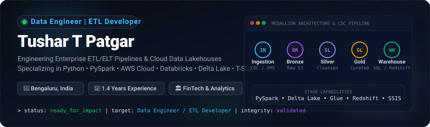

<!-- ========================================================
     GitHub Profile README — Data Engineer Portfolio
     Tushar T Patgar — Bengaluru, India
     ======================================================== -->

  

  
  
  
  
  
  

---

## 🧠 About Me

Data Engineer with **1.4 years of hands-on experience** building enterprise-scale **ETL/ELT pipelines** and cloud-based data solutions across **FinTech** and **analytics** domains. I specialize in designing and delivering reliable data infrastructure — from **CDC ingestion** and **medallion (Bronze–Silver–Gold) architecture** to **incremental processing** and **data quality validation**.

I work primarily in **Python, PySpark, SQL and T-SQL**, and I'm comfortable end-to-end across the modern data stack: **AWS (S3, Glue, DMS, Lambda, Redshift, CloudWatch)**, **Databricks + Delta Lake**, **Apache Airflow**, **dbt**, **Snowflake**, and **SSIS**. My focus is building data products that are accurate, performant, and maintainable — and shipping them safely through production cutovers and migrations.

> *"Building reliable data pipelines, one dataset at a time."*

---

## 📊 GitHub

| Stat | Value |
|------|-------|
| Public Repositories | **7** |
| Primary Focus | Data Engineering · ETL/ELT · Cloud Data Platforms |

  

---

## 🛠️ Technical Skills

### Programming & Query Languages

### Big Data & Lakehouse

### Data Engineering

### Databases & Storage

### AWS Cloud

### Orchestration & DevOps

---

## 💼 Professional Experience

### Software Engineer — Wissen Digital Pvt Ltd
*July 2026 – November 2026 · Bengaluru, India*

- Developed Python- and SQL-based data pipelines for enterprise analytics workloads.
- Engineered AWS data processing solutions using **S3, Lambda, Glue, EC2 and Redshift**.
- Implemented data validation and transformation logic with automated quality checks.
- Supported **incremental processing**, monitoring and ETL troubleshooting in production.

### Data Engineer / ETL Programmer — Endava Solutions Pvt. Ltd
*January 2025 – January 2026 · Bengaluru, India*

- Designed and optimized **SSIS-based ETL pipelines** for high-volume financial and transactional datasets.
- Developed extraction, transformation, cleansing and validation workflows.
- Built **reconciliation and data quality frameworks** to detect mismatches, null anomalies and schema inconsistencies.
- Supported enterprise data migrations, production cutovers and controlled releases.
- Collaborated with QA, business analysts and client stakeholders.

---

## 🏗️ Featured Projects

### 1. SQL Data Warehouse
> Bronze–Silver–Gold architecture with star schema modelling and historical tracking.

- Implemented a layered **Bronze → Silver → Gold** data warehouse architecture.
- Modelled analytical data using **star schema** for query optimization.
- Developed T-SQL ETL workflows with historical tracking (SCD) and analytical query optimization.

| |
|---|
| SQL Server · T-SQL · Data Warehousing · Star Schema |

### 2. Walmart Sales Analytics
> Spark ETL pipeline with schema enforcement, business-rule transforms and Delta Lake incremental loads.

- Built **Spark ETL pipelines** with strict schema enforcement and business-rule transformations.
- Implemented time-based aggregations and **Delta Lake incremental loads using `MERGE INTO`**.

| |
|---|
| Databricks · Spark · Delta Lake · SQL |

### 3. AWS CDC Pipeline
> Automated Change Data Capture from RDS MySQL through DMS, Lambda and Glue into S3.

- Automated **Change Data Capture (CDC)** from AWS RDS MySQL.
- Orchestrated the flow with **DMS and Lambda**, processed with **Glue ETL jobs** and landed data in an **S3 storage architecture**.
- Added **CloudWatch monitoring** for pipeline observability.

| |
|---|
| AWS RDS · DMS · Lambda · Glue · S3 · CloudWatch · Python · Spark |

---

## 📦 Technology Stack

| Layer | Technologies |
|-------|--------------|
| **Languages** | Python · SQL · T-SQL · Spark |
| **Big Data** | Apache Spark · PySpark · Spark SQL · Databricks · Delta Lake · Kafka · Parquet |
| **Cloud** | AWS S3 · AWS Glue · AWS DMS · AWS Lambda · Amazon Redshift · AWS IAM · Amazon Athena · AWS Step Functions · Amazon CloudWatch |
| **Databases** | SQL Server · PostgreSQL · MySQL · Snowflake |
| **Orchestration** | Apache Airflow · dbt · SSIS · Docker · GitHub Actions |
| **Tooling** | Git · GitHub · AWS CLI · Linux · SSMS |

---

## 🏅 Certifications & Education

| Certification | Provider |
|---------------|----------|
| Python for Data Science | O'Reilly |
| Microsoft SQL Server | O'Reilly |
| SQL Server Integration Services | O'Reilly |
| PySpark & AWS: Master Big Data | O'Reilly |

**Education:** Bachelor of Computer Applications (BCA), 2020–2023.

---

## 🤝 Let's Connect

Open to: **Data Engineering Projects · ETL Development · PySpark Projects · Cloud Data Engineering · Open Source**

  
  
  

---

<i>⚡ From <a href="https://github.com/tusharpatgar">tusharpatgar</a> — Building reliable data pipelines, one dataset at a time.</i>

